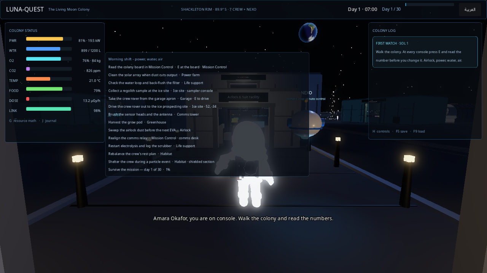
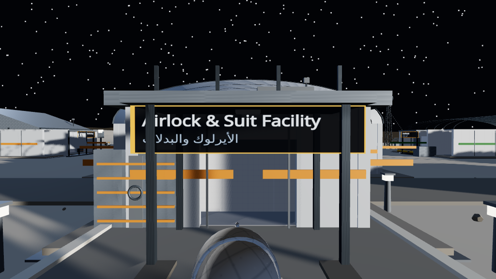
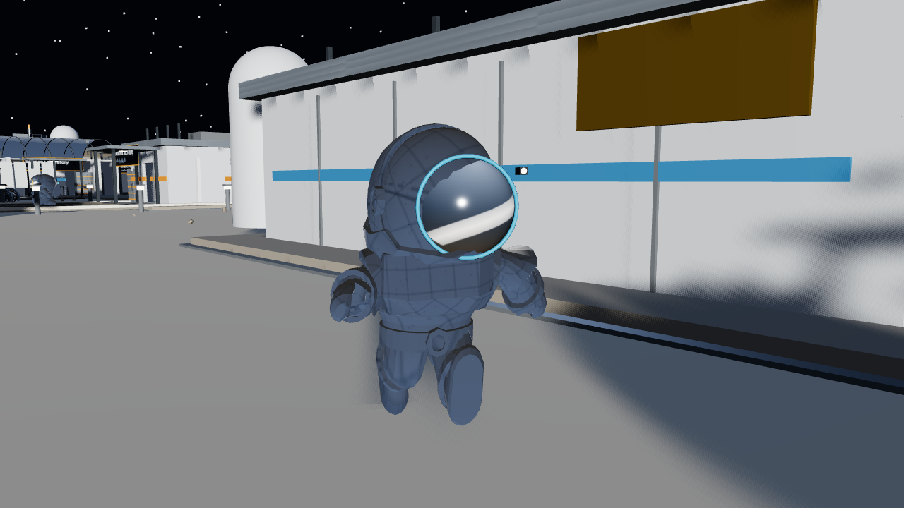

# Luna-Quest — The Living Moon Colony

> **30 Earth days. Six crew, one commander and NEXO the robot. One shared simulation. Every kilogram and every second counted.**



Luna-Quest is a walkable, data-driven lunar colony game. You are the new commander on the
**Shackleton rim at 89.9° S**. Walk the base, read every console, and keep nine people alive
with measured numbers instead of guesses. There is no combat and no permanent failure: the
pressure comes from air, water, power, food, dust, radiation, sleep and time.

The same C# rules run in **Godot 4.7.2 .NET** and **Unity 6.3 LTS**. The engines only draw,
listen and move the player; the simulation is one deterministic core with a shared save file.

---

## Status

| Part | State |
|---|---|
| Shared simulation core | Complete, `netstandard2.1`, 426 automated checks passing |
| Content (buildings, crew, incidents, crops, learning) | Complete, seven JSON files including the voice manifest |
| Godot 4.7.2 .NET project | Complete; built, launched, screenshotted and played on Linux |
| **GDScript project (stock Godot, no .NET)** | **Complete; parses, boots and flies a full thirty-day mission headlessly, 544 rule checks and 174 scene checks passing, exported for Web, Windows and Linux** |
| Unity 6.3 LTS project | Complete; compile-checked with 0 errors against Unity reference assemblies, **not opened in a Unity editor in this build environment** |
| Voice pack | Real recorded MP3 lines, bilingual subtitles, no runtime cloud TTS |
| **Browser edition (Three.js)** | **Complete; built with Vite, played and screenshotted in headless Chromium, 36 web checks passing** |
| CI and releases | `ci.yml` (content + C# core + web), `godot-gdscript.yml` (parse, self-test, scene audit, Web/Windows/Linux exports), `pages.yml` (browser build to Pages), `release.yml` (web ZIP, intro film, Godot .NET and GDScript Windows/Linux/Web) |
| GitHub remote | [Public repository](https://github.com/Mostafa-Taher-git/Luna-Quest), branch `main` |

> The Unity adapter deliberately uses only built-in Unity modules, the built-in render
> pipeline and IMGUI. There is no URP, no third-party package and no package download at
> first open. The Unity project is self-contained under `engines/unity/LunaQuest.Unity`.

---

## Play

### Browser (no install)

The whole colony also runs in a browser. It is plain ES modules on **Three.js** (no engine
download, no plugin), and it loads the same JSON content, runs the same simulation rules,
plays the same intro film and reads the same save files as the C# builds.

```bash
cd web
npm install
npm run dev        # http://localhost:5173
```

```bash
npm run build      # static site in web/dist, ~60 MB with the sketchfab kit models
npm run preview    # serve the production build on http://localhost:4173
npm test           # 36 headless checks: simulation, world build, content wiring
```

Drag the mouse to look, `W A S D` to walk, `Shift` to run, `Space` to jump, `E` to use a
console or talk to a crew member, `V` for the helmet view, `J` for the journal, `H` for help,
`Esc` for the pause screen, `F5`/`F9` to save and load. Saves live in `localStorage` under
`lunaquest-web-save-v2`.




### Godot

```bash
# 1. Build the C# project
dotnet build engines/godot/LunaQuest.Godot/LunaQuest.Godot.csproj

# 2. Open the project in Godot 4.7.2 .NET (mono), then press F5
#    or run it from the command line:
/path/to/Godot_v4.7.2-stable_mono_linux.x86_64 \
  --path engines/godot/LunaQuest.Godot
```

Requirements: **Godot 4.7.2 .NET** and a .NET SDK that supports `netstandard2.1`
(.NET 8 or newer is fine).

### GDScript (stock Godot — no .NET anywhere)

A third project, `engines/godot-gdscript/LunaQuest.GDScript`, is the same game written in plain
GDScript. It needs nothing but a standard Godot 4.7.2 editor, and — unlike the .NET project — it
exports to the web, which is what CI ships as `LunaQuest-GDScript-Web.zip`.

```bash
# one-time: copy the shared astronaut, kit models, intro film and voice pack in
bash tools/sync-gdscript-assets.sh

# then open the project in Godot 4.7.2 (standard, not mono) and press F5, or:
godot --path engines/godot-gdscript/LunaQuest.GDScript

# no GPU required to check it:
godot --headless --path engines/godot-gdscript/LunaQuest.GDScript -- --selftest   # 544 checks
godot --headless --path engines/godot-gdscript/LunaQuest.GDScript -- --audit      # 174 checks
```

Full notes, controls and the file map:
[`engines/godot-gdscript/LunaQuest.GDScript/README.md`](engines/godot-gdscript/LunaQuest.GDScript/README.md).

### Unity

1. Install **Unity 6.3 LTS** (`6000.3.0f1`) through Unity Hub.
2. In Unity Hub choose **Add project from disk** and select
   `engines/unity/LunaQuest.Unity`.
3. Wait for the first import, open `Assets/Scenes/Bootstrap.unity` (it is the default scene),
   then press **Play**.
4. If the scene ever opens without the `LunaQuest` object, create an empty GameObject,
   add the `LunaQuestGame` component, and press Play. This is the only scene in the project.

The Unity project expects `Assets/StreamingAssets/content/*.json` to exist. It is committed
already; after editing `content/`, run `./tools/sync-content.sh` from the repository root
before opening Unity.

### Tests

```bash
dotnet run --project shared/LunaQuest.Tests/LunaQuest.Tests.csproj
```

The console test harness needs no NuGet packages. It checks the clock, resource
conservation, crop and food rules, incidents, learning evidence, save round-trips, every
station console mapping and a full simulated mission. Current result: **426 passed, 0 failed**.

---

## Controls

| Action | Godot | Unity |
|---|---|---|
| Move | `W A S D` | `W A S D` |
| Run | `Shift` | `Shift` |
| Jump | `Space` | `Space` |
| Look | Mouse | Mouse |
| Use the station you face | `E` | `E` |
| First / third person | `V` | `V` |
| Field journal | `J` | `J` |
| Resource math | `G` | `G` |
| Controls / help | `H` | `H` |
| Save / load | `F5` / `F9` | `F5` / `F9` |
| English / العربية | `L` | `L` |
| Pause / resume | `Esc` | `Esc` |
| Close a panel / release the mouse | `Esc` | `Esc` |

The HUD is bilingual. The language switch changes labels, prompts, crew lines and the
journal without restarting the simulation.

### Movement and cameras

- **Third person by default.** The astronaut is visible, the spring arm pulls in when a
  wall is behind the player, and the suit turns toward the direction of travel.
- **First person on `V`.** The camera moves to the helmet, the astronaut mesh is hidden and
  a visor rim, glass reflection and centre crosshair appear. Head bob and a slightly wider
  field of view make the two modes feel different.
- **Low-gravity movement.** Lunar gravity is `1.62 m/s²`. Ground acceleration, air control,
  a `0.14 s` coyote window, a `0.16 s` jump buffer and floor snapping keep the suit from
  feeling floaty or unresponsive.
- **Interaction needs line of sight.** A ray from the centre of the camera must hit the
  console, and the suit must be within reach. Consoles cannot be used through walls.
- **`Esc` is predictable.** It closes an open panel, recaptures a released mouse, pauses the
  colony, or resumes it. The pause screen stops the simulation clock and every resource
  draw.

---

## What is simulated

Every rate is tied to the second. The HUD shows both the human unit (kg/day, L/day, kcal/day)
and the running value; the `G` panel shows the conversion from Earth-day numbers to the
current real-time step.

### Time

| Value | Number |
|---|---|
| Game time | `12` simulated minutes per real second |
| One game day | `120` real seconds |
| 30-day mission | `60` real minutes |
| Lunar synodic month | `29.53059` Earth days |
| Mission start | Day 1, 06:00 |
| Sun at the pole | circles the horizon, roughly ±2° elevation |
| Solar input | `0.80`–`0.96` of full irradiance; no hard day/night switch |

The site is modelled as a polar-summer Shackleton-rim location. The array is vertical and
tracks azimuth, so a grazing Sun still lands close to normal incidence. This is a deliberate
simplification of terrain shadowing, not a claim that the pole is always lit.

### Power

| Value | Number |
|---|---|
| Solar array | `30 kW` peak (≈100 m² at 22% efficiency) |
| Battery | `120 kWh` capacity, starts at `96 kWh` |
| Habitat base load | `12.4 kW` |
| Heater | up to `1.8 kW`, thermostat at `21 °C` |
| Electrolysis | `2.4 kW` when running |
| Grow lights | `2.0 kW` when on |
| Load priority | life support first, lab and greenhouse shed first |

Every step computes `solar − load`, charges or discharges the battery, and sheds the lab and
greenhouse before life support. Dust on the array reduces output until it is cleaned.

### Air

| Value | Number |
|---|---|
| Oxygen use | `0.84 kg` per person per day |
| CO₂ production | `1.00 kg` per person per day |
| Cabin volume | `300 m³` |
| CO₂ warning | above `4,000 ppm` |
| Electrolysis | sized to `90%` of crew demand, so the O₂ reserve declines slowly |
| Plants | consume cabin CO₂ and return O₂ at the `32/44` mass ratio of photosynthesis |

The CO₂ scrubber has health and can be replaced. The electrolysis stack can be repaired.
The air model is a single well-mixed cabin, not a CFD model.

### Water

| Value | Number |
|---|---|
| Crew use | `11 L` per person per day gross |
| Recycler | `93%` recovery (ISS-class) |
| Filter health | degrades; cleaning restores it |
| Grow pod | `24 m²`, `3 L/m²/day` |
| Condensate recovery | `90%` of crop water |
| Tank | `1,200 L` capacity, starts at `900 L` |

The plants therefore use water from the same tank as the crew. Their condensate is recovered,
but the loop is not free: filter health, water quality and power all matter.

### Food and crops

| Value | Number |
|---|---|
| Crew intake | `2,800 kcal` per person per day |
| Stored food | `620,000 kcal` (about 30 crew-days for nine people) |
| Grow pod | `24 m²` in four 6 m² racks, sealed indoors |
| Crop cycle | `24` days (lettuce reference) |
| Harvest | `450 kcal/m²` per cycle |
| Light | `2.0 kW` from colony power, no direct Sun |

Plants are **inside a sealed pod**. The lunar surface has no atmosphere and no useful
radiation shielding, so direct Sun is not an option: the plants get artificial light from the
colony's power budget, cabin CO₂ and stored water. The crop model tracks biomass, health,
water stress and light hours.

### Habitat and crew

| Value | Number |
|---|---|
| Crew | 7 people (commander + 6 crew: Dr. Safaa, Noor, Dr. Alaa, Abdulaziz, Ahmed, Mostafa) + NEXO, the colony robot (no air, food or fatigue) |
| Cabin target | `21 °C` |
| External design temperature | `−55 °C` |
| Surface dose | `13.2 µGy/h` (Chang'e-4 LND median) |
| SPE response | shelter the crew in the shielded section |
| Fatigue / morale | affected by rest, CO₂, cold and food |
| Permanent death | none, by design |

### Dust, comms, incidents and learning

- **Dust** accumulates on arrays, sensors and the airlock. Cleaning recovers output and
  settles drifting readings.
- **Comms** has link quality and relay health; the Earth link can degrade.
- **Incidents** are 15 real-threshold rules: array dust, sensor drift, airlock dust, water
  filter, low water, scrubber life, high CO₂, low O₂, crop stress, radiation, comms, fatigue,
  low power, low food and an ice discovery.
- **Learning** is evidence of work done, not a quiz. Eleven objectives record a concept and a
  skill in the field journal. Reading an observation station unlocks its objective; the
  journal then shows what was practiced and the source/evidence class.

### Voice and subtitles

Every crew member has a distinct recorded voice identity, a greeting and four rotating
ambient barks. Fifteen incident lines are spoken by the crew member who owns that system.
The current pack is **55 real MP3 lines**, generated offline with Piper from open voice
models, and every line carries an English and Arabic subtitle. The game never calls a cloud
speech service at runtime.

- Greetings play when you talk to a crew member.
- Barks are short, spaced out, and never loop into a wall of dialogue.
- Incident lines are chosen from the same fixed pack, so a missing file is a build error,
  not a surprise at runtime.
- `--voice-check` loads every pack entry and reports missing keys or files.
- `--voice-demo` speaks one greeting at startup, for audio checks.

The models and their licenses are listed in `docs/licenses/piper-voices.md`. The Arabic
text is a subtitle translation, not Arabic speech.

---

## The 30-day arc

The mission starts at **Day 1, 06:00** so the first shift, meal and maintenance round are
ahead of the player. The Sun moves slowly around the horizon. The colony autosaves when the
mission day changes; `F5` and `F9` save and load on demand.

The sim is deterministic at a fixed **1-second** step, with a frame accumulator in front of
it. The clock changes presentation only; the resource arithmetic is the same in both engines.

---

## Architecture

```text
                    content/*.json
                          │
                          ▼
              ┌───────────────────────┐
              │  LunaQuest.Core       │  netstandard2.1, no engine types
              │  clock · power · air  │
              │  water · food · crops │
              │  thermal · dust ·     │
              │  radiation · comms    │
              │  incidents · learning │
              │  NPCs · save contract │
              └───────────┬───────────┘
                          │
          ┌───────────────┴────────────────┐
          ▼                                ▼
  Godot 4.7.2 .NET adapter        Unity 6.3 adapter
  C# + procedural 3D              C# + procedural 3D
  GLB astronaut, frozen 0.4 s     baked OBJ astronaut
  Godot HUD (Control nodes)       IMGUI HUD
```

- The core never references `UnityEngine` or `Godot.*`.
- Each adapter owns rendering, input, audio, camera, scene construction and its own save
  file location.
- The save **format** is shared: IDs and values only, never scene hierarchies.
- Unity cannot compile C# outside its project root, so the core sources are mirrored into
  `Assets/Scripts/Core` by `tools/sync-content.sh`. Edit `shared/LunaQuest.Core`, never the
  mirror.

### Repository layout

```text
Luna-Quest-Game/
├── assets/                  astronaut GLB, Earth texture, fonts, voice pack
├── content/                 source-of-truth JSON: buildings, npcs, incidents,
│                            crops, learning, research, voice manifest
├── docs/                    design docs, research, screenshots, licenses
├── engines/
│   ├── godot/LunaQuest.Godot/          Godot 4.7.2 .NET edition (C#)
│   ├── godot-gdscript/LunaQuest.GDScript/  stock Godot edition (GDScript, web-exportable)
│   └── unity/LunaQuest.Unity/
├── shared/
│   ├── LunaQuest.Core/      simulation, content loader, save contract
│   └── LunaQuest.Tests/     console test harness
├── web/                     browser edition (Three.js + Vite): terrain, colony, crew,
│                            intro film, HUD, dialogue, save/load
├── tools/                   content sync, astronaut bake, voice-pack generator,
│                            sync-gdscript-assets.sh
├── README.md
├── CREDITS.md
└── LICENSE
```

---

## Content and modding

The seven JSON files in `content/` are the source of truth for both engines:

| File | Contents |
|---|---|
| `buildings.json` | 16 buildings, footprints, rooms and interaction points |
| `npcs.json` | 6 crew profiles + NEXO (`isRobot`), schedules, skills, trust and story seeds |
| `incidents.json` | 15 threshold-driven incidents with safe next steps |
| `crops.json` | 9 crop references and cycle data |
| `learning.json` | 11 objectives and evidence classes |
| `research.json` | 17 research notes and source links |
| `voices.json` | voice cast, every spoken line and its Arabic subtitle |

The parser is dependency-free (`shared/LunaQuest.Core/Content/Json.cs`), so Unity, Godot and
the tests read the same bytes with the same rules.

After editing content or assets:

```bash
./tools/sync-content.sh
```

This copies JSON, the shared core, textures, fonts and the voice pack into both engine
projects and the Unity core mirror. It does not overwrite engine adapter code. Godot then
needs an import pass (`Godot --headless --import --path engines/godot/LunaQuest.Godot`)
after new audio or textures are added.

### Rebuilding the Unity astronaut

Unity uses a static OBJ baked from the repaired GLB at the standing `0.4 s` pose. The GLB in
Godot is the animated source, frozen at the same pose:

```bash
python3 tools/bake_astronaut_obj.py
```

The baker writes `Assets/Resources/Art/Astronaut/cute_astronaut_baked.obj` and `.mtl`.
It uses only the Python standard library.

### Developer flags

Godot:

```bash
# Skip the name screen, render one frame and quit
Godot --path engines/godot/LunaQuest.Godot --autostart \
  --screenshot=/tmp/luna.png --shot-delay=6

# Front portrait for model checks
Godot --path engines/godot/LunaQuest.Godot --autostart --portrait \
  --screenshot=/tmp/portrait.png --shot-delay=5

# Start in the helmet view, at a fixed position and look direction
Godot --path engines/godot/LunaQuest.Godot --autostart --first-person \
  --spawn=-2.9,15.2 --look=0,0 --screenshot=/tmp/station.png --shot-delay=6

# Verify the whole voice pack, then quit
Godot --headless --path engines/godot/LunaQuest.Godot -- --voice-check

# Speak one greeting at startup, for an audio check
Godot --path engines/godot/LunaQuest.Godot --autostart --voice-demo
```

`--spawn=x,z` and `--look=yaw,pitch` are development helpers for repeatable screenshots.
They are inert in normal play. Unity has no screenshot flag; press Play and use the Game
view. The start overlay is the same name/language screen.

---

## Save files

| Engine | Location |
|---|---|
| Godot | `user://lunaquest-save.json` |
| Unity | `Application.persistentDataPath/lunaquest-save.json` |

Schema version `2`. The save stores IDs and values, not engine objects. A save produced by
one adapter can be loaded by the other after copying the file to the other engine's path.

---

## Known limitations and pending items

- **Unity was not opened in this environment.** It has been compiled against Unity reference
  assemblies with 0 warnings/0 errors, and the scene/project files are hand-authored. The
  first editor open may regenerate missing `Library/`, `QualitySettings` or `GraphicsSettings`
  files; that is normal. Use Unity 6.3 LTS and the built-in render pipeline.
- **Voice is synthetic and English-only.** The 55 lines were generated offline with Piper
  from open voice models. Arabic is a subtitle translation; there is no Arabic speech in the
  pack. The models and licenses are listed in `docs/licenses/piper-voices.md`.
- **Dialogue is bark-based.** Each crew member has a greeting and four ambient lines rather
  than a branching conversation tree. The exposition lives on the consoles and in the
  journal, which keeps the HUD readable and the voices short.
- **Crew v3:** the two unnamed engineer roles were retired. NEXO, the floating colony robot
  from the AstroNexa intro, now owns the greenhouse and the comms tower: it follows the
  commander, answers eight topics, speaks with a processed robot voice, and flags warnings
  by turning its screen eyes orange.
- **The Unity astronaut is static.** Godot uses the GLB frozen at 0.4 s; Unity uses a baked
  OBJ at the same pose. Re-run the baker after changing the GLB.
- **The simulation is single-zone.** Air and thermal models are well-mixed cabin
  approximations, not compartment-level CFD.
- **No combat, no permanent death, single player, Moon only.** These are design rules, not
  missing features.

---

## Credits

- **Cute Astronaut** by **haefu** on Sketchfab — CC BY 4.0. Repaired and dressed for this
  project; see `CREDITS.md`.
- **Earth texture** from Solar System Scope — CC BY 4.0.
- **DejaVu Sans** and **Noto Naskh Arabic** fonts under their respective free licenses.
- Crew voice pack generated offline with **Piper** from open voice models; cast and licenses
  in `docs/licenses/piper-voices.md`.
- Design, research and content from the Luna-Quest team (GDD v2.2, architecture v2.2).

Full attribution and license texts: [`CREDITS.md`](CREDITS.md) and
[`docs/licenses/`](docs/licenses/).

## License

Source code is released under the **MIT License** (see [`LICENSE`](LICENSE)). Third-party
art, fonts, voice and research documents remain under their own licenses; the MIT license
does not override them. See [`CREDITS.md`](CREDITS.md) for the current notices.
