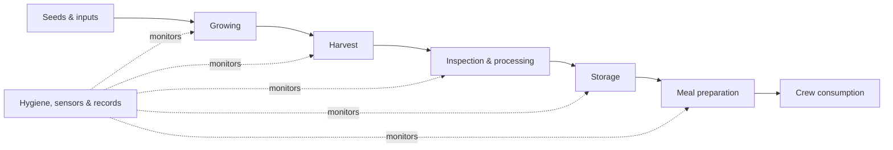
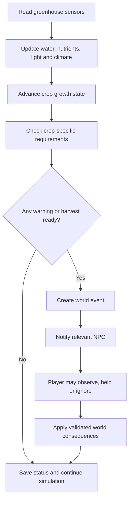

the api = https://www.asc-csa.gc.ca/eng/youth-educators/toolkits/food-production/

<div align="center">

# LUNA ACADEMY
## FOOD PRODUCTION & LUNAR GREENHOUSE RESEARCH
### A science-backed design reference for the Living Moon Colony


**Research pack · v1.0 · 13 November 2026**  
**Primary source:** Canadian Space Agency — Food Production Toolkit  
**Game context:** Single-player 3D open-world Moon-colony sandbox · Ages 7–13

</div>

---

> **Purpose**  
> This document filters the Canadian Space Agency (CSA) Food Production toolkit for information that matters to growing, storing, preparing and safely eating food in a long-duration lunar settlement. It translates the science into systems, buildables, NPC stories and open-world situations for **Luna Academy**.
>
> **Evidence labels used throughout**  
> - **[CSA lunar guidance]** — CSA content explicitly discusses growing food on the Moon.  
> - **[Spaceflight analogue]** — demonstrated or described for the ISS/spaceflight; useful, but not automatically identical to the lunar surface.  
> - **[Earth analogue]** — a terrestrial project or activity that offers design lessons for a remote, harsh environment.  
> - **[Game proposal]** — a gameplay abstraction or future-colony design choice, not a measured lunar engineering specification.

## 3D quick view — what the food system needs


| System | Job in the colony | Why it matters |
|---|---|---|
| Grow Pod / greenhouse | Grow edible crops in a controlled environment | Packaged resupply cannot be the only long-term food plan |
| Utility Pod | Control water, nutrients, air, temperature and sensors | Plants need stable growing conditions |
| Power Pod | Supply electricity for pumps, lighting and climate control | A crop can be lost when essential systems fail |
| Seed & nursery store | Store seeds and start new crop batches | Enables crop rotation and recovery after failure |
| Harvest & food-safety station | Inspect, wash/process, portion and store crops | Contamination can happen at several stages |
| Kitchen & pantry | Combine fresh and preserved food into balanced meals | Colony health depends on variety, nutrition and reliable inventory |

**Design principle:** the greenhouse is not an isolated decoration. It is a life-support-adjacent production system connected to power, water recovery, air management, food storage, the kitchen and crew schedules.

---

# 1. Executive findings

The CSA toolkit points to six high-value principles for a lunar food system:

1. **Do not grow food directly in exposed lunar regolith.** The Moon lacks an Earth-like atmosphere and the regolith does not provide the nutrients plants need. Use a protected, controlled growing environment. [CSA lunar guidance]
2. **Hydroponics or aeroponics are sensible design candidates.** They let the colony control the root environment instead of relying on untreated lunar soil. [CSA lunar guidance]
3. **Select crops as a system, not just by appearance.** Consider nutrition, edible biomass, crop size, pollination, growth time, ease of cultivation, crew preference and requirements for light, nutrients, temperature, water, humidity and air. [CSA lunar guidance]
4. **Prioritize fast, low-processing crops early.** CSA describes “pick-and-eat” crops as useful because an early lunar crew may have limited food-processing equipment. [CSA activity]
5. **Keep packaged food and grown food together.** Growing food supports freshness and variety, but does not mean a small early greenhouse can feed the entire crew. [CSA spaceflight guidance]
6. **Food safety is a chain.** Contamination can occur during growing, harvesting, processing, transport, storage and preparation. NASA created the HACCP approach for space-food safety in the 1960s. [CSA food-safety resource]

## What this means for Luna Academy

The child should be able to build a greenhouse, choose crops, run experiments, diagnose plant stress, manage food stocks, plan balanced meals and respond to a contamination warning. The game should teach the reason behind each action rather than merely asking the player to click “water plant.”

---

# 2. Lunar growing environment: constraints the game must respect

## 2.1 A greenhouse must be a controlled habitat

**[CSA lunar guidance]** The CSA identifies the following challenges for growing on the Moon:

| Constraint | Scientific meaning | Game-system implication |
|---|---|---|
| No breathable atmosphere | Plants need a controlled supply of the gases required for growth; an exposed plant cannot grow normally on the lunar surface | Greenhouse pressure shell and air-control system are required |
| Nutrient-poor regolith | Lunar surface material is not ready-made agricultural soil | Use hydroponic/aeroponic root systems and a controlled nutrient solution |
| Water availability | Liquid water is not readily available at the surface; water near the poles may be accessible but still requires extraction/processing | Water is a valuable input; connect greenhouse demand to the colony water-recovery system |
| Radiation | The Moon has no global protective magnetic field like Earth's; the surface is exposed to space radiation | Put crops inside a shielded habitat; include radiation monitoring as a system status |
| Temperature extremes | External conditions can be severe and vary by location and illumination | Insulation, thermal control and redundant sensors are essential |
| Light cycle | At the equator the lunar day/night cycle is roughly 28 Earth days, with about 14 days of daylight and 14 days of darkness; some south-polar locations have near-continuous sunlight | Use local illumination data; do not give every Moon location the same day/night schedule |

**Important interpretation:** “Almost constant sunlight” at the lunar South Pole does **not** mean every point is always lit. Local ridges, crater rims and topography create shadow. The game should model the selected site, not assume permanent sunlight everywhere.

## 2.2 Do not confuse lunar gravity with microgravity

ISS plant experiments take place in microgravity. A lunar surface greenhouse would operate at about one-sixth of Earth's gravity, inside a pressurized habitat. The CSA's ISS plant hardware is useful for environmental-control ideas—temperature, oxygen, carbon dioxide and adjustable LED lighting—but the game must not claim that plant growth in lunar gravity is already fully characterized by ISS results.

## 2.3 Grow-system options

| Method | How it works | Luna Academy treatment |
|---|---|---|
| Hydroponics | Roots receive water containing dissolved nutrients, usually with a support medium | **Primary MVP system**: readable water/nutrient loops and easy-to-understand maintenance |
| Aeroponics | Nutrient solution is delivered to roots as a mist | Advanced optional system; efficient but more sensitive to pump/nozzle faults |
| Controlled growth chamber | Sealed room regulates temperature, humidity, air composition and lighting | Required habitat envelope around either method |
| Regolith experiment plot | Tests treated lunar material as a substrate in a contained lab experiment | Research-only activity; never present raw exposed regolith as ordinary fertile soil |

---

# 3. Crop selection data from the CSA

The CSA's **Interplanetary Farming** activity lists potential crops, example nutrients, approximate growth times and processing requirements. These are planning values from the educational resource, not guaranteed Moon-grown harvest times. Cultivar, seed lot, light, temperature, nutrient solution and other conditions can change results.

## 3.1 Candidate crop table

| Crop | Approximate growth time in CSA resource | Useful nutrition noted by CSA | Preparation noted by CSA | Game role |
|---|---:|---|---|---|
| Green-leaf lettuce | 21–28 days | Vitamins K, A and C | None | Fast early harvest; salad and morale |
| Soybean | 45–65 days | Protein, carbohydrates, fats, calcium, magnesium, iron, folate | Boil in shell | Protein crop; later processing unlocks more foods |
| Tomato | 50–90 days | Carbohydrates, vitamins A, C and K, fibre | None | Fresh food and variety |
| Carrot | 70–80 days | Vitamins A and K, potassium, carbohydrates, fibre | None | Storage-friendly crop candidate; roots need suitable growing volume |
| Chickpea | 80 days for immature shell beans; 100 days for dried | Protein, carbohydrates, fats, magnesium, manganese, iron, folate, fibre | Fresh at 80 days; cook at/after 100 days | Protein and pantry crop |
| Sweet potato | 90–170 days | Vitamins A and C, carbohydrates, B6, B vitamins, potassium, magnesium, fibre | Boil or cook | High edible value, but long growth cycle |
| Basil | About 75 days | Vitamins K and A | None | Herbs, flavour and menu variety |
| Dill | About 90 days | Vitamins A and C, manganese, fibre | None | Herb and food-variety crop |
| Wheat | 213–244 days (7–8 months) | Carbohydrates, protein, iron, magnesium, phosphorus, B vitamins, folate, zinc, manganese, selenium | Grind into flour | Long-term staple; requires processing equipment |

**Source note:** The crop times above are quoted as approximate planning values from the CSA activity. They are not measured lunar-field performance data. In-game crop cycles should be configurable and clearly labelled “simulation values.”

## 3.2 Crop selection scorecard

When a player chooses a crop, the game should show more than a single “profit” number:

- **Nutrition:** Which dietary contribution does it provide?
- **Edible biomass:** How much of the plant can be used as food?
- **Growth duration:** How long until harvest?
- **Resource demand:** Water, nutrients, lighting and climate-control demand.
- **Footprint:** How much rack/floor area is needed?
- **Processing requirement:** Can the crew eat it directly, or does it need cooking/grinding?
- **Pollination:** Does the crop require assistance, and what method is available in the greenhouse?
- **Crew preference:** Does the menu gain variety and morale value?
- **Risk:** How sensitive is it to a missed watering, temperature swing or lighting fault?

### Suggested early, middle and late colony crop mix

| Colony capability | Suggested crop mix | Why |
|---|---|---|
| Starter greenhouse | Leaf lettuce, herbs | Fast, edible with little processing, good for teaching the crop cycle |
| Expanded greenhouse | Tomatoes, soybeans, carrots | Adds variety, protein and more demanding crop management |
| Established colony | Chickpeas, sweet potatoes, wheat | Longer cycles and more processing; requires reliable utilities and kitchen equipment |

This is a **game progression recommendation**, not a CSA-approved lunar crop prescription.

---

# 4. Greenhouse systems architecture


## 4.1 Grow Pod

Contains growing racks, root-zone trays, seed-starting station, plant sensors, lighting and harvest access.

**Player interactions:**
- Select and plant seeds.
- Inspect germination and leaf/root health.
- Add or adjust nutrient solution.
- Set light schedule and spectrum.
- Check plant spacing and growth stage.
- Harvest, weigh and log produce.

## 4.2 Utility Pod

Contains pumps, filters, water tanks, nutrient mixing, air circulation, humidity control and environmental sensors.

**Player interactions:**
- Check tank levels and filter condition.
- Read water-quality and nutrient indicators.
- Trace a leak or blocked line.
- Compare greenhouse readings with crop needs.
- Replace a failed pump or sensor.

## 4.3 Power Pod

Contains electrical distribution, battery storage and backup power connections. Solar power can be the primary source at a suitable site, but the greenhouse must have energy storage and a safe response to long shadows, dust, equipment faults or high demand.

**Player interactions:**
- Review power consumption by subsystem.
- Decide which non-critical loads can be reduced.
- Schedule high-energy lighting when generation/storage permits.
- Repair or clean external power equipment safely.

## 4.4 Why the modular layout is a good reference

The CSA describes the **Naurvik** project in Nunavut as three repurposed shipping-container pods: Grow Pod, Utility Pod and Power Pod. It is an Earth-based hydroponic project in a remote, harsh climate, not a lunar installation. Its value for Luna Academy is the modular separation of growing, utilities and power. Do **not** copy its wind-power component to the Moon: the Moon has no useful atmosphere for wind turbines.

---

# 5. Plant growth controls and experiment data

The CSA describes ISS growth systems with environmental monitoring/control for temperature, oxygen and carbon dioxide, plus white, red, blue and green LED lighting that can be tailored to plant requirements.

| Control | What it affects | What the player should learn |
|---|---|---|
| Light intensity / schedule | Photosynthesis and growth cycle | More light is not automatically always better; crops have requirements |
| Light spectrum | Plant response and growth development | Different LED channels can be adjusted for an experiment |
| Temperature | Germination, growth and plant stress | Maintain the crop's suitable range |
| Water delivery | Root hydration and nutrient transport | Avoid both under-watering and system leaks/over-watering |
| Nutrient solution | Essential mineral supply | Nutrient imbalance can produce visible symptoms |
| Humidity | Water loss and greenhouse environment | Air and water conditions interact |
| CO₂ / O₂ balance | Plant and habitat gas management | Plant chambers need monitored gas composition |
| Pollination | Fruit/seed formation in crops that require it | Some crops need a pollination plan; do not assume every crop self-pollinates |

**Data integrity rule:** The CSA pages do not provide a universal numeric setpoint for each crop in this toolkit. Do not invent exact pH, EC, temperature, humidity, LED intensity or CO₂ targets and label them as CSA specifications. For implementation, create configurable simulation parameters and attach a crop-specific agronomy reference before claiming real values.

## 5.1 The Tomatosphere experiment pattern

The CSA describes an education program in which students receive two seed batches—one space-exposed or space-like batch and one control batch—grow them without knowing which is which, measure germination and growth, and submit results. This is a strong template for scientific gameplay:

1. Form a question.
2. Set up a control and a test group.
3. Keep the growing conditions consistent except for the tested variable.
4. Record germination rate and growth measurements.
5. Compare the results.
6. Explain uncertainty instead of claiming one result proves everything.

The game must not imply that “space-exposed seeds” automatically become better lunar crops. The experiment teaches controlled comparison, not a guaranteed adaptation effect.

---

# 6. From harvest to a safe meal

Food production is only half the system. The colony also needs to preserve, inspect, prepare and distribute its food.

## 6.1 Food categories described by CSA

| Category | Examples | Why the colony needs it |
|---|---|---|
| Fresh | Fruits and vegetables | Variety, freshness and morale |
| Natural form | Nuts, tortillas | Simple ready-to-eat options |
| Dried | Dried fruit, dried meat | Longer storage and reduced mass/volume |
| Irradiated | Some meat products | Food preservation through microbial reduction; must be handled under approved food standards |
| Rehydratable | Spinach, drinks and meals | Water added at mealtime; compact storage |
| Thermostabilized | Tuna salad, desserts and other heat-treated meals | Shelf-stable reserve food |

The CSA notes that ISS food is planned and tracked, normally with three meals and one snack per day. It also gives a broad ISS energy range of **1,900–3,200 kcal per astronaut per day**, depending on the individual. This is an ISS reference range, **not** a universal lunar diet prescription and not a number that should be used as a child-health target in the game.

## 6.2 Pantry and kitchen gameplay

- Store food by type, batch, expiry/best-before date and quantity.
- Rehydrate or heat packaged meals when appropriate.
- Prepare fresh produce safely.
- Build balanced menus with variety and nutritional coverage.
- Track stock against crew schedules and estimated resupply windows.
- Reserve emergency food without making every meal a punishment mechanic.

## 6.3 Food has a social and psychological function

CSA notes that meals provide a chance for crew members to relax, connect and share culture. Variety and familiar foods can support morale and reduce food boredom. For Luna Academy, communal meals should be a relationship activity as well as a nutrition system.

---

# 7. Food safety: a colony-wide responsibility

CSA's food-safety activity describes contamination risks at production, processing, distribution, preparation and storage. It also explains that NASA created **HACCP (Hazard Analysis and Critical Control Points)** for the space-food program in the 1960s.

## 7.1 The food-safety chain



**Common contamination routes from the CSA resource:**
- Contaminated irrigation water or growing inputs.
- Poor hand hygiene or an unwell handler.
- Unsanitary tools, processing surfaces or equipment.
- Incorrect storage temperature or damaged packaging.
- Cross-contamination between raw and ready-to-eat food.
- Contamination that cannot be seen by looking at the food.

## 7.2 Game mechanic: HACCP-style checkpoints

The child should learn a simplified preventive approach:

1. Identify where contamination could enter.
2. Inspect a relevant sensor, batch record or work surface.
3. Isolate a suspicious batch rather than distributing it.
4. Ask the responsible NPC to verify the test or procedure.
5. Clean/repair the source using the correct equipment.
6. Re-test and release the batch only when the fictional system reports it safe.

This is educational gameplay, not real food-handling or medical advice.

---

# 8. Real-world analogues worth translating into the game

## 8.1 Naurvik — remote hydroponics

**What it demonstrates:** three modular pods (Grow, Utility, Power), hydroponic production, renewable power, local technician training, and the first harvest of butter lettuce and microgreens in a harsh Arctic environment.

**Use in Luna Academy:** modular construction, clear maintenance roles, local skills, and a greenhouse that depends on utility and power modules.

**Do not copy:** the project's wind turbines as a lunar power source.

## 8.2 CANGrow — modular food production

The CSA reports that Ecoation's CANGrow concept can produce a diverse range of fresh foods, including strawberries, cherry tomatoes and mycelial meat substitute, with a **potential** of more than **700 kg of nutrient-dense food annually** using minimal resources.

**Important:** “potential” is not the same as verified continuous output in a lunar habitat. Treat this as an example of ambitious modular indoor-farm design, not a guaranteed game production rate.

## 8.3 ISS plant growth systems

The CSA describes the Veggie and Advanced Plant Habitat approaches: prepared seed/root media, controlled growth chambers and environmental controls for plant experiments.

**Use in Luna Academy:** seed trays, sealed growth modules, sensor displays, adjustable lighting and experiment logs.

## 8.4 Tomatosphere

**Use in Luna Academy:** player-led control-vs-test experiments that reward measurement and honest interpretation rather than random guessing.

---

# 9. Luna Academy gameplay translation

## 9.1 New buildables for the Moon-colony construction system

| Buildable | Function | Dependencies | Upgrade direction |
|---|---|---|---|
| Starter Grow Pod | Small hydroponic racks and seed nursery | Habitat connection, power, water, thermal/air control | More rack capacity, better sensors |
| Utility Pod | Pumps, filters, nutrient mixing and environmental controls | Power and water lines | Redundant pumps, improved filtration, additional sensors |
| Power Pod | Distributes and buffers electricity | Grid connection and energy source | More storage, fault isolation, backup circuits |
| Seed Bank | Stores and catalogs seed batches | Stable storage conditions | More varieties, better inventory tracking |
| Harvest & QC Station | Weighs, inspects and logs crops | Grow Pod connection | Batch traceability, testing tools |
| Food Processing Bench | Performs simple preparation/preservation tasks | Water, power and food-safe surfaces | More processing methods and capacity |
| Cold/Dry Pantry | Stores perishable and shelf-stable foods | Power and monitoring | More capacity and better monitoring |
| Colony Kitchen | Turns ingredients into planned meals | Pantry and food-safety workflow | More menu options, improved meal variety |

**Construction rule:** a building should have a footprint, a site suitability check, utility connection points, material cost, build time, maintenance needs and visible upgrade stages. Use the same readable base-building loop inspired by Clash of Clans—place, connect, build, upgrade—but replace combat and arbitrary coin upgrades with realistic colony functions and dependencies.

## 9.2 Open-world situations (no forced level order)

| Situation | What happens in the world | Player choices | Skills learned |
|---|---|---|---|
| First germination | A seed tray has uneven sprouting | Compare seed batches, inspect moisture/light records | Observation, fair testing, biology |
| Nutrient imbalance | Leaf colour/growth pattern changes | Inspect the solution, ask Amina, compare crop requirements | Plant science, evidence-based diagnosis |
| Lighting interruption | A rack receives less light than scheduled | Check the circuit, use backup power, prioritize racks | Electricity, prioritization |
| Water recovery fault | Utility Pod supply becomes limited | Repair filter/pump, reduce non-critical use | Water cycle, systems thinking |
| Pollination problem | Fruit set is low in a crop requiring pollination | Inspect flowers and choose an appropriate controlled method | Plant reproduction, engineering |
| Suspected contamination | A harvest batch fails a safety check | Quarantine, trace the batch, inspect hygiene checkpoints | Food safety, responsibility |
| Harvest planning | Several crops approach maturity | Harvest now or wait, check pantry and crew menu | Arithmetic, forecasting, planning |
| Crew meal request | NPCs want more variety or a familiar dish | Plan a balanced shared meal from pantry and fresh harvest | Nutrition, empathy, inventory |
| Long-cycle crop decision | Wheat or sweet potato uses rack space for months | Compare long-term benefits against quick crops | Opportunity cost, patience, resource management |

## 9.3 NPC responsibilities and story hooks

- **Amina — Botanist / food-production lead:** crop experiments, seed selection, pollination and harvest planning. Personal story: she wants the greenhouse to become a stable source of fresh food, but must learn not to treat a failed experiment as personal failure.
- **Omar — Systems engineer:** maintains pumps, nutrient delivery, power connections and climate-control equipment. Story hook: a small maintenance shortcut causes a chain of crop stress; he must rebuild trust by documenting repairs.
- **Sofia — Medical officer:** supports nutrition, hygiene, food-safety awareness and crew well-being. Story hook: she notices that repetitive meals are lowering morale and works with the player on a varied menu.
- **Maya — Commander:** balances colony priorities and approves expansion based on power, water and crew capacity. Story hook: she must choose between expanding production and protecting the reliability of existing life-support systems.
- **Leo — Robotics and automation specialist:** maintains greenhouse sensors, crop imaging, inventory scanning and robotic assistance. Story hook: a sensor misclassification teaches the player that automated readings need human verification.

## 9.4 Rewards that reinforce learning

Avoid rewarding only the largest harvest. Reward:
- Correct experiment setup and record keeping.
- Safe batch handling and accurate tracing.
- Balanced menu planning.
- Reducing wasted water or energy without harming crops.
- Diagnosing the cause of a problem, not just replacing parts.
- Helping an NPC learn or improve a procedure.
- Maintaining crop diversity and reliable stock over time.

---

# 10. Learning outcomes for ages 7–13 (without an age-selection gate)

The same world activity can support different levels of depth. The game observes how much support the player needs; it does not ask them to choose an age bracket.

| Skill domain | What the child can learn | Example in-game evidence |
|---|---|---|
| Biology | Germination, plant needs, life cycles, pollination | Predicts and observes seed growth |
| Chemistry | Nutrient mixtures, filtration, contamination concepts | Identifies a solution/filter issue |
| Mathematics | Counting, ratios, growth days, stock forecasts, percentages | Plans harvest and food inventory |
| Nutrition | Food groups, variety, balanced meals | Builds a menu for crew needs |
| Engineering | Pumps, sensors, LED systems, maintenance | Finds a fault and restores a system |
| Scientific method | Hypothesis, control group, measurements, evidence | Compares two seed batches fairly |
| Responsibility | Hygiene, record keeping, careful use of shared resources | Isolates questionable food instead of distributing it |
| Teamwork & empathy | Listening, cultural food preferences, shared meals | Resolves an NPC meal request fairly |
| Systems thinking | Power-water-air-food dependencies | Understands why one failure affects crop production |
| Sustainability | Reuse, recycling, minimizing waste | Closes a water/nutrient loop where appropriate |

---

# 11. Data model for the game

The downloadable `food_production_game_data.json` stores crop candidates and their CSA-listed planning durations. Recommended schema fields:

```json
{
  "cropId": "lettuce_green_leaf",
  "displayName": "Green-leaf lettuce",
  "sourceGrowthDays": { "min": 21, "max": 28 },
  "source": "CSA Interplanetary Farming activity",
  "evidenceType": "educational planning value; not lunar trial result",
  "processing": "none listed",
  "nutritionTags": ["vitamin_k", "vitamin_a", "vitamin_c"],
  "simulationGrowthDays": { "min": 21, "max": 28 },
  "simulationNote": "Configurable game value; test and balance separately"
}
```

**Implementation recommendation:** keep `sourceGrowthDays` separate from `simulationGrowthDays`. The first is a sourced planning reference; the second is an adjustable game-balance variable. They must never silently overwrite one another.

## 11.1 Suggested system events

```text
CROP_SEEDED
GERMINATION_RECORDED
GROWTH_SENSOR_WARNING
NUTRIENT_SOLUTION_LOW
WATER_FILTER_WARNING
LIGHTING_CIRCUIT_FAILED
POLLINATION_REQUIRED
HARVEST_READY
HARVEST_COMPLETED
FOOD_BATCH_QUARANTINED
FOOD_BATCH_RELEASED
PANTRY_STOCK_LOW
MEAL_PLAN_UPDATED
```

## 11.2 Simulation update loop



---

# 12. Suggested MVP scope for the food-production feature

Build the smallest meaningful loop first:

1. One walkable greenhouse room with 2–3 grow racks.
2. One water/nutrient tank and one controllable pump.
3. One lighting system with visible on/off and intensity controls.
4. Three crops: lettuce, tomato and soybean.
5. Seed → germination → growth → harvest states.
6. A small pantry showing fresh stock and expiry/inventory status.
7. One meal-planning interaction with Sofia.
8. One crop-stress incident and one suspected food-safety incident.
9. Amina NPC with daily greenhouse routine and a short personal story.
10. A science journal that records what the player tested and observed.

**MVP acceptance criteria:**
- Player can seed, grow and harvest at least three crop types.
- Each crop has distinct growth duration and processing requirements drawn from the source table or clearly labelled simulation assumptions.
- Power/water/light interruptions can affect growth state.
- The player can inspect crop status and understand why a warning occurred.
- Harvest creates a traceable food batch in the pantry.
- A suspicious batch can be quarantined and not served until cleared by the game's fictional inspection process.
- Player receives a short explanation connecting the action to real-world science.

---

# 13. Scientific accuracy and limitations

1. CSA's crop growth days are approximate candidate-planning values, not lunar greenhouse trial results.
2. ISS plant experiments are microgravity experiments; lunar surface gravity is about one-sixth of Earth's. Do not treat the environments as identical.
3. CSA says the Moon's regolith lacks the nutrients needed for normal plant growth; do not depict an open-air farm planted directly in raw lunar dust.
4. A lunar greenhouse must be a protected, pressure-controlled environment with thermal, atmospheric, lighting and radiation considerations.
5. South-polar illumination can be favorable at some locations, but local terrain shadows matter. A greenhouse should have backup lighting and power storage.
6. The CANGrow figure is a reported *potential* of more than 700 kg/year for a concept system, not demonstrated output on the Moon.
7. Naurvik is a remote-Arctic Earth analogue. Its modular pods are relevant; its wind power is not a lunar solution.
8. ISS calorie figures are contextual spaceflight references only. The game should teach balanced nutrition without prescribing personal calorie targets to children.
9. HACCP-style gameplay should teach prevention, traceability and safe decisions, not replace real food-safety training.

---

# 14. Source library

**Primary source — CSA Food Production Toolkit**  
[Toolkit for educators and youth – Food production on the Moon and in remote areas](https://www.asc-csa.gc.ca/eng/youth-educators/toolkits/food-production/)  
The toolkit index groups food-in-space reading, experiments, Tomatosphere, infographics, videos and water-recycling resources. Page last modified: 26 May 2026.

**Core technical / educational sources**

1. [CSA — Interplanetary Farming](https://www.asc-csa.gc.ca/eng/youth-educators/activities/fitness-and-nutrition/interplanetary-farming.asp) — crop candidates, growth durations, nutrients, lunar growing constraints and controlled environments.
2. [CSA — Growing healthy food in space and in remote areas](https://www.asc-csa.gc.ca/eng/sciences/food-production/growing-healthy-food-in-space-and-remote-areas.asp) — resupply limits, long-duration self-sufficiency and controlled-environment agriculture. Page last modified: 24 July 2026.
3. [CSA — Naurvik project in Nunavut](https://www.asc-csa.gc.ca/eng/sciences/food-production/naurvik-project-in-nunavut.asp) — modular Grow/Utility/Power Pods, hydroponics, renewable power and technician training.
4. [CSA — Deep Space Food Challenge](https://www.asc-csa.gc.ca/eng/sciences/food-production/deep-space-food-challenge.asp) — minimal-input food systems, CANGrow potential and other concepts. Page last modified: 12 February 2026.
5. [CSA — Eating in space](https://www.asc-csa.gc.ca/eng/astronauts/living-in-space/eating-in-space.asp) — food formats, storage, nutrition, meal preparation and crew morale. Page last modified: 4 September 2026.
6. [CSA — Keeping Food Safe on Earth and in Space](https://www.asc-csa.gc.ca/eng/youth-educators/activities/fitness-and-nutrition/keeping-food-safe-on-earth-and-in-space.asp) — contamination routes and HACCP.
7. [CSA — Healthy Meals in Microgravity](https://www.asc-csa.gc.ca/eng/youth-educators/activities/fitness-and-nutrition/healthy-meals-in-microgravity.asp) — meal planning and food inventory as a spaceflight analogue.
8. [CSA — Tomatosphere](https://www.asc-csa.gc.ca/eng/youth-educators/tomatosphere.asp) — student-led seed comparison, germination and growth measurements.
9. [CSA — Water recycling on the ISS](https://www.asc-csa.gc.ca/eng/multimedia/search/video/17876) — example of water recovery in a closed space habitat.

**Research reviewed on:** 13 November 2026.  
**Use note:** This is a filtered design-research document, not a complete review of all agricultural research and not an engineering certification for a real lunar habitat.

---

<div align="center">

## BUILD FOOD. PROTECT THE HARVEST. FEED THE COLONY.

**Luna Academy — Living Moon Colony**  
*Curiosity is the first crop. Evidence is how it grows.*

</div>
