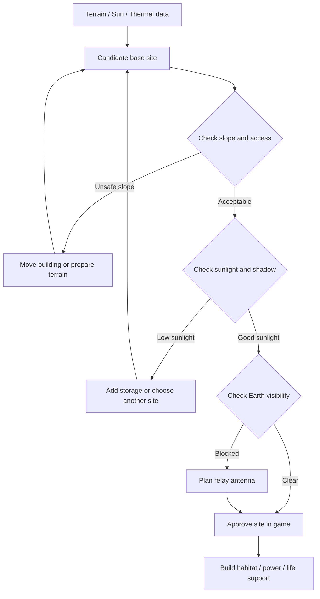
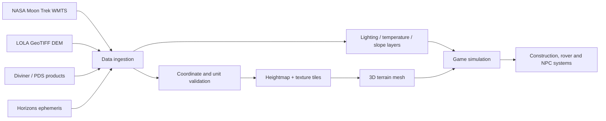

the api =https://api.nasa.gov/

<div align="center">


# LUNA ACADEMY
## NASA API RESEARCH — THE MOON & LIVING ON THE MOON

**Scientific data • 3D environment • Base building • NPC simulation • Education**

`RESEARCH v1.0` · `13 NOVEMBER 2026` · `MOON-ONLY GAME WORLD`

</div>

> **Scope note:** This is a relevance-filtered guide to the NASA API catalog at [api.nasa.gov](https://api.nasa.gov/) and closely related official NASA/JPL data services that are more useful for lunar development. The catalog is curated; NASA says it does not contain every NASA API. There is no single endpoint that provides all the data needed to live on the Moon. The useful data is distributed across several missions, instruments, archives and services.

---

# 1. Executive summary — what to use first

The strongest sources for Luna Academy are:

| Priority | Source | What it gives the game | Best use |
|---|---|---|---|
| **P0** | [NASA Moon Trek / WMTS](https://trek.nasa.gov/moon/) | Lunar imagery layers, map projections, terrain-analysis tools and map products | 3D world basemap, map navigation and terrain planning |
| **P0** | [LOLA South Pole DEM / PGDA](https://pgda.gsfc.nasa.gov/data/LOLA_5mpp/) | South-polar elevation, slope, uncertainty and point-cloud products; selected products at 5 m/pixel | Real terrain mesh, construction placement, rover routes |
| **P0** | [NASA/JPL Horizons API](https://ssd-api.jpl.nasa.gov/doc/horizons.html) | Time-dependent positions and observer geometry for the Sun and Earth from a lunar surface location | Sun angle, illumination planning, Earth visibility and communication windows |
| **P0** | [LRO Diviner archive](https://pds-geosciences.wustl.edu/missions/lro/diviner.htm) | Infrared/radiometric observations and derived lunar surface temperature products | Thermal map, habitat thermal challenge, rover/equipment limits |
| **P1** | [PDS Search API](https://nasa-pds.github.io/pds-api/guides/search/endpoints.html) + [LRO data products](https://science.nasa.gov/mission/lro/data-products/) | Search and discover archived lunar mission products | Find LROC, LOLA, Diviner, LEND and other science products |
| **P1** | [NASA Image and Video Library API](https://images.nasa.gov/docs/images.nasa.gov_api_docs.pdf) | Searchable NASA imagery, video and metadata | Reference images, museum/journal entries, learning moments |
| **P2** | [APOD WordPress API](https://science.nasa.gov/wp-json/wp/v2/apod-basic/) | Date-based astronomy picture and explanation | Optional educational daily discovery feed; not simulation data |
| **P2 / existing integration** | [DONKI](https://ccmc.gsfc.nasa.gov/tools/DONKI/) | Solar flares, CMEs and solar energetic particle event reports | Space-weather warning scenarios; not a local lunar radiation dosimeter |
| **P2 / existing integration** | [NASA OSDR](https://osdr.nasa.gov/bio/repo/) | Human/animal/cell biology datasets from spaceflight and analogue studies | Inform crew-health learning content; not direct lunar clinical predictions |

**Recommended first implementation:** Moon Trek imagery + LOLA terrain + Horizons solar geometry + Diviner temperature context. These four sources influence how the Moon looks, where the player can build, how the colony receives energy, and how equipment must handle temperature.

---

# 2. What “filter the NASA API data” means here

The NASA API portal is an API catalogue, not one database with a universal date filter. Each service has its own query fields and each mission dataset has its own observation period. I filtered the catalogue by **usefulness to a Moon-only settlement game**, then recorded the time coverage where an archive or product provides it.

## Inclusion rules

1. Is the data about the Moon, a lunar mission, the lunar environment, or a human-spaceflight analogue that helps model life support?
2. Can the data drive a visible or interactive game system?
3. Does the source document the instrument, units, coverage, uncertainty or limitations?
4. Can the game preserve the original provenance rather than turning a scientific estimate into a fake certainty?

## What is not treated as lunar ground truth

- Earth-observation APIs do not become lunar weather data.
- Mars weather or Mars rover APIs do not describe the Moon.
- Near-Earth asteroid catalogues do not provide a direct probability of a meteoroid striking the player's particular lunar base.
- Solar energetic particle event alerts do not by themselves equal dose received by an astronaut inside a shielded lunar habitat.
- A temperature or illumination model is not the same thing as a thermometer at every game coordinate.

---

# 3. The most valuable NASA/JPL source: Moon Trek

[Open NASA Moon Trek](https://trek.nasa.gov/moon/) · [Moon Trek WMTS API documentation](https://trek.nasa.gov/tiles/apidoc/trekAPI.html?body=moon) · [About Moon Trek](https://trek.nasa.gov/moon/jpl/config/textAbout.html)

Moon Trek is the most directly useful source for creating the lunar surface. NASA/JPL describes it as an interactive portal that brings together observations from lunar missions, supports 3D visualization, flyovers, map layers, distance and elevation profiles, lighting and slope analysis, and data-product downloads. Basic map data is publicly available; some advanced mission-planning tools require a registered account.

## 3.1 Layers and tools relevant to the game

| Data / tool | Real-world meaning | Game implementation |
|---|---|---|
| LRO WAC global mosaic | Wide-angle camera imagery mosaic | Global lunar base texture / map reference |
| LROC north- and south-polar mosaics | Polar surface imagery | High-priority south-pole texture and landmark reference |
| LOLA elevation / DEM | Surface elevation derived from laser altimetry | Height map for terrain mesh and collision ground |
| Elevation profile | Height changes along a drawn traverse | Rover route preview and slope lesson |
| Slope analysis | Local terrain angle | Buildable-area checks; rover and construction access |
| Surface lighting / Sun-angle tools | Whether and when a place receives sunlight | Solar farm placement and day/shadow schedule |
| Line of sight | Whether terrain blocks a view/path | Earth communications, antenna placement and rover relay planning |
| Electrostatic potential | Modelled lunar surface electrical environment | Advanced dust/electrostatic educational scenario; not a simple dust-density map |
| Crater / rock detection and feature layers | Surface landforms and selected hazards | Exploration, geology and safe navigation activities |

## 3.2 A documented global imagery tile example

Moon Trek's WMTS documentation provides the following LRO WAC global mosaic example:

```text
https://trek.nasa.gov/tiles/Moon/EQ/LRO_WAC_Mosaic_Global_303ppd_v02/1.0.0/default/default028mm/0/0/0.jpg
```

The tile template is:

```text
https://{WMTS endpoint}/1.0.0/{Style}/{TileMatrixSet}/{TileMatrix}/{TileRow}/{TileCol}.{extension}
```

Do **not** guess the style, tile-matrix set, zoom IDs or image extension for another map layer. Fetch that product's `WMTSCapabilities.xml` and read the identifiers, bounding box, tile matrices and resource URL. Missing tiles can indicate no coverage at that position/zoom.

## 3.3 3D terrain data from LOLA

NASA's Planetary Geodesy and Geophysics archive provides high-resolution South Pole LOLA terrain products. The listed products include:

- `LDEM`: interpolated surface elevation, in metres.
- `XYZI`: adjusted point clouds.
- `LDEC`: LOLA spot-count / data-support map.
- Slope map, in degrees.
- Elevation and slope uncertainty products.

For the cited South Pole products, the GeoTIFF products are **5 metres per pixel** in a south-polar stereographic coordinate system, referenced to `MOON_ME` with ephemeris `DE421`. Coverage is specific to sites/regions; it is not a uniform 5 m/pixel DEM of the entire Moon.

### Important landing-site terrain numbers

NASA's lunar-surface data book reports the following approximate South Pole surface-area distribution of slopes, derived from a 5 m-baseline LOLA DEM for latitudes poleward of 87°S:

| Slope | Approximate area share |
|---|---:|
| 0–5° | 25% |
| 5–10° | 32% |
| 10–15° | 23% |
| 15–20° | 12% |
| Above 20° | 8% |

The same report describes 5 m/pixel slope products with median RMS slope errors of about 1.5–2.5°. These figures are useful for a **gameplay terrain model**, not a substitute for site-specific engineering qualification.

**Use in Luna Academy:**

- Choose a realistic relief for the South Pole map.
- Make construction preview turn red or warn on slopes beyond the building's defined limit.
- Give rovers different traction / stability on flat, moderate and steep ground.
- Teach why a small slope change matters for a heavy habitat or a rover carrying equipment.
- Use the data-support and uncertainty layer to avoid pretending every pixel is equally certain.

Sources: [PGDA South Pole LOLA DEMs](https://pgda.gsfc.nasa.gov/data/LOLA_5mpp/), [PGDA high-resolution site products](https://pgda.gsfc.nasa.gov/products/78), [NASA Lunar Surface Data Book (PDF)](https://ntrs.nasa.gov/api/citations/20250002845/downloads/M2M-30044%20Lunar%20Surface%20Data%20Book%20Baseline_Final.pdf).

---

# 4. Sunlight, shadow and the lunar South Pole

The South Pole is a compelling setting for Luna Academy because sunlight is highly terrain-dependent. Near the lunar poles, the Sun stays close to the horizon; high ridges may receive long periods of illumination while deep crater floors can remain permanently shadowed.

NASA SVS has published South Pole illumination simulations using LRO LOLA topography:

| Product | Period / coverage | Temporal sampling | What it supports |
|---|---|---|---|
| [Illumination at 80°S](https://svs.gsfc.nasa.gov/5027/) | 2025–2028; region south of 80°S | Every 2 hours; 17,532 steps | Long-term power and shadow planning |
| [Illumination at 88°S](https://svs.gsfc.nasa.gov/4930/) | 2023–2030; region south of 88°S | Every 2 hours; 35,064 steps | Detailed near-pole shadow simulation |

NASA explains that in the polar region the Sun can remain very low above the horizon, and terrain features can cast extremely long shadows. Some permanently shadowed regions (PSRs) may never receive direct sunlight.

## 4.1 Design the game lighting system correctly

Avoid a normal Earth-style sunrise / sunset loop for a South Pole outpost. Instead:

1. Give every map coordinate its own illumination profile.
2. Let terrain height and nearby ridges determine shadows.
3. Use a game-time clock linked to a precomputed illumination table or geometry model.
4. Let solar arrays output power according to their orientation, shadow and dust state.
5. Keep permanently shadowed regions cold and dark in the appropriate simulation zones.
6. Make rover headlights and navigation beacons useful in shadowed terrain.

The 2-hour NASA visualisation samples are not a real-time light sensor. Interpolation between samples is a game approximation and should be labelled as such.

## 4.2 A strong settlement-planning lesson

Shackleton Crater is a useful visual teaching example: NASA describes illuminated parts of its rim and a permanently shadowed interior. The crater is about 19 km across, and selected rim locations have favourable illumination. This does **not** mean the entire rim is continuously sunlit or that the crater floor is an easy place to build.

**Game mechanic:** The player compares three candidate plots:

- **Ridge Site:** Stronger sunlight and better potential communications, but exposed and potentially steep.
- **Sheltered Bench:** Easier building access, but more shadow at certain times.
- **Crater Interior:** Interesting science target and potential ice-search area, but extremely cold, dark and difficult to access.

This is a site-selection puzzle, not a fixed correct-answer quiz. The player balances power, slope, access, communication and scientific value.

Sources: [NASA SVS 2025–2028](https://svs.gsfc.nasa.gov/5027/), [NASA SVS 2023–2030](https://svs.gsfc.nasa.gov/4930/), [NASA Shackleton rim and shadow](https://science.nasa.gov/resource/shackleton-craters-illuminated-rim-shadowed-interior/).

---

# 5. Thermal environment — Diviner

[Diviner data archive](https://www.diviner.ucla.edu/data) · [PDS Geosciences Node: LRO Diviner](https://pds-geosciences.wustl.edu/missions/lro/diviner.htm)

Diviner is a multi-channel radiometer aboard LRO. It maps lunar surface temperature and thermal emission. The PDS archive documents:

| Product type | Coverage shown in archive |
|---|---|
| Raw EDR records, bundle LRODLR_0001 | 5 July 2009 – 31 December 2016 |
| Raw EDR records, bundle LRODLR_0002 | 1 January 2017 – 15 June 2026 |
| Calibrated RDR records, bundle LRODLR_1001 | 5 July 2009 – 31 December 2016 |
| Calibrated RDR records, bundle LRODLR_1002 | 1 January 2017 – 15 June 2026 |

The Diviner archive also links to global and polar temperature maps. Published descriptions report lunar surface temperature mapping at roughly 500 m horizontal scales for some products. Product-specific resolution and temporal aggregation must be checked in the relevant PDS label before use.

**In the game:**

- Show a thermal layer on the map.
- Model equipment operating ranges rather than assuming every area has one fixed temperature.
- Make a habitat require insulation, radiators / thermal-control hardware and protected routing for sensitive equipment.
- Let a player compare a warm sunlit slope with an ultra-cold shadowed crater zone.
- Use the recorded data as context and calibrate a simplified simulation; do not claim Diviner measured every building site continuously.

**Important:** A surface-temperature observation is not the temperature inside a pressurised habitat, inside a spacesuit or in a buried shelter. Those require separate thermal models.

---

# 6. Sun and Earth geometry — JPL Horizons API

[Horizons API documentation](https://ssd-api.jpl.nasa.gov/doc/horizons.html) · [Horizons manual](https://ssd.jpl.nasa.gov/horizons/manual.html)

Horizons can calculate ephemerides and observer geometry. The system supports surface targets on major bodies, including the Moon (body ID `301`), using geodetic coordinates. The API supports a time range and a sampling interval.

## 6.1 How Luna Academy should use it

- Calculate Sun azimuth and elevation at a selected lunar site and game date.
- Calculate when Earth is geometrically visible from a surface position.
- Plan communication windows and antenna pointing.
- Compare Sun angle at two potential solar-array locations.
- Produce a daily/seasonal schedule for power availability.

Horizons is a geometry / ephemeris service. It does not tell the game whether a radio link works through a mountain, whether a dust storm blocks hardware, or whether a solar array is damaged. Combine it with terrain line-of-sight and the Moon Trek map.

## 6.2 Request design template

The following is a **template** for requesting an observer ephemeris of the Sun from a geodetic position on the Moon. Replace longitude, latitude, altitude and dates with the selected site. Validate the exact request and returned fields in Horizons before using it in production.

```text
https://ssd.jpl.nasa.gov/api/horizons.api?
format=json
&COMMAND='10'
&OBJ_DATA='NO'
&MAKE_EPHEM='YES'
&EPHEM_TYPE='OBSERVER'
&CENTER='coord@301'
&COORD_TYPE='GEODETIC'
&SITE_COORD='EAST_LONGITUDE_DEG,LATITUDE_DEG,ALTITUDE_KM'
&START_TIME='2026-11-13'
&STOP_TIME='2026-11-14'
&STEP_SIZE='30m'
&QUANTITIES='4,9,10'
```

Where:

- `COMMAND='10'` selects the Sun.
- `301` is the Moon.
- `SITE_COORD` uses east longitude, latitude and altitude according to Horizons coordinate conventions.
- `START_TIME`, `STOP_TIME` and `STEP_SIZE` define the time sampling.
- `QUANTITIES` selects observer-table outputs; confirm the desired quantity codes from the current Horizons documentation.

For a surface feature as a target, Horizons also documents target forms such as `g:east_longitude,latitude,height@301`. This is useful when calculating the geometry of a specific crater or landing-site point.

**Engineering recommendation:** Do not send a Horizons request every rendered frame. Precompute the selected game calendar into a compact local table (e.g. samples every 10–30 minutes, if suitable), cache it, and interpolate smoothly in the game. Recompute only when the site, date or simulation model changes.

---

# 7. Water, ice and lunar resources

The lunar resource story is important but must not be oversimplified.

NASA's lunar water summaries describe evidence from multiple missions and instruments:

- Permanently shadowed regions have temperatures that can preserve water ice and other volatiles.
- LRO instruments such as LEND help identify hydrogen-rich areas; hydrogen is evidence relevant to water but is not a direct measurement of a mineable water tank.
- LAMP observations help characterize permanently shadowed regions.
- M3 observations from Chandrayaan-1 identified water ice signatures in permanently shadowed regions.
- LCROSS impact observations added evidence for water ice in a permanently shadowed crater.
- SOFIA announced evidence for molecular water on sunlit lunar surface regions in 2020, but that is not equivalent to accessible bulk ice.

Sources: [NASA Moon Water and Ices](https://science.nasa.gov/moon/moon-water-and-ices/), [LRO science and data](https://science.nasa.gov/mission/lro/science-and-data/), [NASA LRO permanent shadows fact sheet](https://science.nasa.gov/wp-content/uploads/2024/01/lro-litho5-shadowed.pdf).

## Game implementation

Create a **Resource Prospecting Layer** with confidence classes, not a guaranteed resource icon:

| Map label | Meaning | Player action |
|---|---|---|
| Evidence of hydrogen / water-related signatures | Remote sensing evidence; composition and accessibility uncertain | Send a prospecting rover |
| Candidate cold trap | Temperature and illumination geometry suggest volatile preservation may be possible | Perform a sampling mission |
| Confirmed sample result (fictional mission result) | The game has collected a local sample and analysed it | Decide whether extraction is worth the cost |
| Extractable reserve (fictional engineering estimate) | A scenario-specific estimate after prospecting and processing tests | Build a pilot extraction unit |

The player should learn that **finding evidence of water, proving water ice is present at a location, and extracting useful water are three different steps**.

Do not colour all dark craters blue and claim every one contains accessible ice.

---

# 8. PDS Search API — find and download the real lunar products

[PDS API overview](https://nasa-pds.github.io/pds-api/) · [Search API endpoint guide](https://nasa-pds.github.io/pds-api/guides/search/endpoints.html) · [LRO data products](https://science.nasa.gov/mission/lro/data-products/)

PDS is NASA's archive for planetary science products. Its Search API can discover products, inspect metadata and resolve data products. The documented base endpoint is:

```text
https://pds.nasa.gov/api/search/1/
```

## Example keyword searches

```bash
# Find lunar LOLA elevation products
curl -G 'https://pds.nasa.gov/api/search/1/products' \
  --data-urlencode 'keywords=Moon LRO LOLA elevation DEM' \
  --data-urlencode 'limit=20'

# Find Diviner lunar temperature products
curl -G 'https://pds.nasa.gov/api/search/1/products' \
  --data-urlencode 'keywords=LRO Diviner lunar surface temperature' \
  --data-urlencode 'limit=20'

# Discover available search properties
curl -L 'https://pds.nasa.gov/api/search/1/properties'
```

PDS supports search parameters including `keywords`, `q`, `fields`, `sort`, `limit` and pagination (`search-after`). Product-class and field names should be taken from the current API response/properties documentation rather than guessed. PDS warns that not all archived datasets may be populated in every search index; a product may be available at its node archive even if a general search returns no result.

## Instruments worth searching

| Instrument / mission | Data type | Gameplay role |
|---|---|---|
| LRO LOLA | Elevation, slope, topography | Terrain mesh, construction and rover mobility |
| LRO LROC WAC / NAC | Images and high-resolution observations | Ground texture, landmarks and exploration |
| LRO Diviner | Infrared / thermal measurements | Thermal zones and equipment constraints |
| LRO LEND | Neutron measurements related to hydrogen abundance | Water-prospecting confidence layer |
| LRO LAMP | Far-ultraviolet observations | Shadowed-region science context |
| GRAIL | Lunar gravity-field models | Advanced science visualization and optional gravity lesson |

---

# 9. NASA Image and Video Library API — visual learning content

[API documentation PDF](https://images.nasa.gov/docs/images.nasa.gov_api_docs.pdf) · [NASA Image and Video Library](https://images.nasa.gov/)

This API is useful for finding reference material and educational media, not for generating accurate terrain geometry.

## Example searches

```text
https://images-api.nasa.gov/search?q=Moon%20South%20Pole%20LRO&media_type=image
https://images-api.nasa.gov/search?q=Artemis%20lunar%20habitat&media_type=image
https://images-api.nasa.gov/search?q=Apollo%20lunar%20rover&media_type=image
```

The API supports a search endpoint and separate asset/metadata/caption endpoints. Use the returned NASA ID to request the asset manifest and source metadata.

**Game uses:**

- Science journal entries that show actual Apollo and LRO images.
- NPC discussions comparing a real photograph with a simplified 3D game environment.
- Historical mission stories and equipment reference.
- Educational galleries about craters, regolith, polar terrain and lunar instruments.

Before bundling a downloaded media item into the game, read its credit/copyright metadata. Do not assume every file returned by a NASA-hosted search has identical usage rights; some records may include third-party material.

---

# 10. APOD — optional daily astronomy discovery

The NASA API portal reports that APOD migrated to a new WordPress endpoint on **10 September 2026**. The portal says the legacy APOD API is scheduled to be taken offline on **1 December 2026**. Use the new endpoint for new work:

```text
GET https://science.nasa.gov/wp-json/wp/v2/apod-basic/
```

Date-range example:

```text
https://science.nasa.gov/wp-json/wp/v2/apod-basic/?start_date=2026-11-01&end_date=2026-11-13
```

The new endpoint supports `date`, `start_date`, `end_date` and `count` parameters. It returns fields such as date, title, permalink, media type, explanation, credit and media URL.

**Recommended use:** an optional “Discovery of the Day” journal entry when the APOD is relevant to the Moon, the Sun, Earth or space exploration. Do not use APOD as a scientific simulation feed or assume every daily image is about the Moon.

---

# 11. Other APIs in the NASA portal — include, reuse or exclude

| API / service | Decision | Reason |
|---|---|---|
| DONKI (FLR, CME, SEP, IPS, etc.) | **Reuse as supporting integration** | Helps schedule space-weather awareness scenarios. Its event reports do not equal a local lunar habitat radiation dose. |
| OSDR | **Reuse as supporting integration** | Spaceflight and analogue biology can inform crew-health education, microbiology and human adaptation. It is not a lunar clinical reference. |
| SSD/CNEOS CAD / Sentry / Scout | **Limited / do not treat as lunar forecast** | Primarily small-body and Earth close-approach / impact-risk services. Not a direct lunar surface meteoroid flux sensor. |
| Asteroids NeoWs | **Exclude from base survival simulation** | Near-Earth object catalogue, not a forecast of objects striking a specific lunar base. |
| EPIC | **Exclude from lunar terrain** | Earth-observing spacecraft imagery; may be a source for the appearance of Earth from space, not a Moon surface map. |
| Earth / EONET / GIBS | **Exclude as Moon environment data** | Earth systems and Earth imagery. Do not map these to lunar weather. |
| Mars Insight Weather / Mars Rover Photos | **Exclude** | Mars-specific, not the Moon. |
| TLE API | **Exclude from lunar map / site planning** | Standard TLE records are for Earth-orbiting objects; not a substitute for lunar spacecraft ephemerides. |
| Exoplanet API | **Exclude** | No direct relevance to living on the Moon. |

This filtering is intentional: more APIs do not automatically make a better simulation. Use only sources whose physical meaning matches the system being simulated.

---

# 12. Turn the data into Luna Academy systems

## 12.1 Recommended simulation data model

| Game system | Data input | Runtime variable | What the player sees |
|---|---|---|---|
| Terrain | LOLA DEM + LROC mosaic | `elevation_m`, `slope_deg`, `terrain_texture` | Hills, crater rims, paths, building plots |
| Lighting | LOLA + illumination products + Horizons | `sun_azimuth_deg`, `sun_elevation_deg`, `illumination_fraction` | Long shadows, solar array output |
| Thermal | Diviner products + simplified thermal model | `surface_temp_context`, `thermal_zone` | Heat/cold warning, equipment limits |
| Communications | Horizons Earth geometry + terrain LOS | `earth_visible`, `link_quality_estimate` | Antenna alignment and relay planning |
| Water prospecting | LEND / LAMP / M3 / LCROSS context | `resource_evidence_class`, `confidence` | Candidate survey areas, sample missions |
| Geology | LROC imagery, LOLA, GRAIL | `crater_id`, `rock_type_hypothesis`, `gravity_model` | Exploration notebook and sample analysis |
| Space weather | DONKI SEP / FLR / CME | `space_weather_alert` | NPC warning, optional shelter-preparation event |
| Learning journal | Image Library + APOD + science archive | `source_id`, `credit`, `explanation` | Real-world evidence attached to a discovery |

## 12.2 Site-selection score (game design proposal)

The following is a **gameplay scoring model**, not a NASA-certified landing-site selection formula:

```text
site_score =
    0.30 * solar_access_score
  + 0.25 * terrain_safety_score
  + 0.20 * communication_visibility_score
  + 0.15 * logistics_access_score
  + 0.10 * science_value_score
```

All component scores should be normalized to 0–100 and display uncertainty. The weights are adjustable balancing parameters. A child should see why a site scores well or poorly rather than being told that one site is universally best.

## 12.3 Example cause-and-effect chain



---

# 13. Build the 3D Moon from real data

## 13.1 Recommended data pipeline



## 13.2 Coordinate-system rules

- Do not mix a south-polar stereographic GeoTIFF directly with an equirectangular texture without a deliberate reprojection.
- Preserve the product's coordinate reference system, datum, body-fixed frame and units.
- Record pixel size and map resolution in metadata.
- Preserve no-data pixels and uncertainty layers.
- Store the original source product ID and download date alongside every derived game asset.
- Convert the selected area into a local game coordinate frame only after reprojection and validation.

## 13.3 Suggested implementation tools

| Task | Suggested tool |
|---|---|
| Download / inspect GeoTIFF and PDS products | GDAL, Python rasterio, PDS tools |
| Reproject polar products | `gdalwarp` |
| Build mesh / decimate | Blender, mesh processing scripts |
| Create heightmap tiles | GDAL / Python |
| Render 3D terrain | Three.js / React Three Fiber |
| Display imagery tiles | WMTS client or tile loader |
| Compute ephemeris | JPL Horizons API; cache results |

### A cautious development sequence

1. Start with one small South Pole region rather than the entire Moon.
2. Load the LOLA DEM for a selected region.
3. Reproject/clip to a local metre-based coordinate system.
4. Create a heightmap and a low-resolution collision mesh.
5. Apply a matching LROC/WAC imagery texture.
6. Add a slope overlay and validate a few known points against source metadata.
7. Add precomputed sunlight/shadow data.
8. Add Diviner thermal context.
9. Add candidate water-resource areas as uncertain science overlays.
10. Only then build the base-building grid on top of the validated terrain.

---

# 14. API keys, rate limits and reliability

NASA's API portal documents these general defaults (individual services may vary):

- A registered API key: default limit of **1,000 requests per hour** across `api.nasa.gov` services.
- `DEMO_KEY`: **30 requests per IP per hour** and **50 requests per IP per day**.
- Rate-limit response headers include `X-RateLimit-Limit` and `X-RateLimit-Remaining`.
- Moon Trek WMTS and JPL Horizons are separate services; do not assume the `api.nasa.gov` key authenticates them.

**Production recommendations:**

- Use your own NASA API key for services that require it.
- Never expose private service keys in a public front-end bundle. Proxy requests through a controlled backend if a key must remain secret.
- Cache static terrain tiles, historical images and immutable metadata.
- Cache Horizons ephemeris for the exact site/date/model version.
- Treat 429, 5xx, empty coverage and missing tiles as normal recoverable states.
- Keep offline fallback data for the area where the child is currently playing.
- Store `source_url`, `source_product_id`, `retrieved_at_utc`, `units`, `resolution`, `crs`, `uncertainty` and `processing_version` in every derived asset.

---

# 15. Suggested Luna Academy API registry (for developers)

| ID | Source | Integration type | Refresh policy | API key |
|---|---|---|---|---|
| `moon_trek_wmts` | Moon Trek WMTS | Static / tiled map imagery | Cache tiles by zoom and area | No NASA API key documented for public basic tiles |
| `lola_dem_south_pole` | PGDA / PDS | Downloadable scientific raster / point cloud | Versioned data ingestion | Archive-specific; check product page |
| `diviner_rdr` | PDS Geosciences Node | Scientific data archive | Re-check release / new coverage | Archive-specific; check endpoint |
| `horizons_ephemeris` | JPL Horizons | Time-series calculation API | Recompute by site and game calendar | No `api.nasa.gov` key documented |
| `pds_search` | PDS Search API | Product discovery | On demand / catalogue refresh | No key described in API guide |
| `nasa_images` | NASA Image and Video Library | Search / asset manifests | On demand; cache metadata | API documentation says open REST API |
| `apod_wp` | NASA Science APOD WordPress | Date-based content feed | Daily / date request | Portal shows api_key parameter |
| `donki` | CCMC DONKI | Event feed | Poll / update windows | `api.nasa.gov` key |
| `osdr` | NASA OSDR | Study metadata and file discovery | Catalogue update / selected study refresh | Check OSDR docs |

---

# 16. Recommended gameplay scenarios grounded in these datasets

| Scenario | Real data inspiration | Learning objectives | Player action |
|---|---|---|---|
| Find a safe habitat site | LOLA elevation + slope + illumination | Geometry, measurement, risk evaluation | Compare 3 candidate plots |
| Plan a solar farm | South Pole illumination + Horizons | Energy, angles, time-series reasoning | Orient arrays and choose storage |
| Rover gets stuck on a steep route | LOLA slope map | Force, traction, route planning | Choose a safer path |
| Cold equipment failure | Diviner thermal context | Heat transfer, insulation, engineering | Protect a pipe or battery enclosure |
| Water prospecting expedition | LEND/LAMP/M3/LCROSS evidence | Scientific uncertainty, sampling, chemistry | Send rover, collect and analyse a sample |
| Earth link is obstructed | Horizons geometry + terrain LOS | Communications, geometry, teamwork | Select antenna / relay location |
| Solar event warning | DONKI SEP / FLR / CME | Space weather, radiation, preparedness | NPCs coordinate a shelter-preparation drill |
| Science discovery journal | NASA Image Library / APOD | Research literacy, evidence and attribution | Compare an image with an in-game simulation |

None of these should become a forced sequence of levels. They are optional events, projects and discoveries in the living Moon sandbox.

---

# 17. Data quality, uncertainty and scientific honesty

Every game data field should be tagged with one of these evidence levels:

| Badge | Meaning | Game representation |
|---|---|---|
| **Observed** | Direct instrument measurement or image-derived observation | Show instrument, date and resolution |
| **Derived** | Product calculated from one or more observations | Show method and input dataset |
| **Modelled** | Physics / ephemeris / thermal / illumination model | Show model assumptions and time coverage |
| **Inferred** | Scientific interpretation from indirect evidence | Show uncertainty; avoid certainty language |
| **Fictional scenario value** | Tuned gameplay number | Label as simulation parameter, not NASA measurement |

Do not combine:

- Surface temperature with habitat internal temperature.
- Remote-sensing hydrogen evidence with proven extractable water reserves.
- Sunlight percentage with guaranteed electrical output.
- Earth visibility with guaranteed radio throughput.
- Solar particle flux (pfu) with astronaut absorbed dose.
- A 5 m/pixel map with 5 m absolute positional accuracy.

---

# 18. Source catalogue and research references

All sources below were checked or referenced for this research snapshot on **13 November 2026**. Some data archives update independently; re-check product versions and coverage when importing into the game.

## NASA API catalogue and portal

1. [NASA Open APIs — api.nasa.gov](https://api.nasa.gov/) — service catalogue, APOD, DONKI, NASA Images, OSDR, SSD/CNEOS, Moon Trek WMTS and API usage information.
2. [NASA API authentication and rate limits](https://api.nasa.gov/assets/html/authentication.html) — key and rate-limit policy.
3. [NASA Image and Video Library API documentation](https://images.nasa.gov/docs/images.nasa.gov_api_docs.pdf) — REST search, asset manifest, metadata and captions.

## Lunar maps and terrain

4. [NASA Moon Trek](https://trek.nasa.gov/moon/) — lunar map, polar imagery and analysis tools.
5. [Moon Trek WMTS API documentation](https://trek.nasa.gov/tiles/apidoc/trekAPI.html?body=moon) — layer IDs, tile matrices, capabilities and map tile rules.
6. [About Moon Trek](https://trek.nasa.gov/moon/jpl/config/textAbout.html) — 3D visualization, data layers, elevation profiles, lighting and slope analysis.
7. [PGDA South Pole LOLA DEMs](https://pgda.gsfc.nasa.gov/data/LOLA_5mpp/) — high-resolution DEM, point cloud, slope and uncertainty products.
8. [PGDA high-resolution LOLA site products](https://pgda.gsfc.nasa.gov/products/78) — candidate South Pole landing-site data and illumination-related products.
9. [NASA Lunar Surface Data Book baseline (2025)](https://ntrs.nasa.gov/api/citations/20250002845/downloads/M2M-30044%20Lunar%20Surface%20Data%20Book%20Baseline_Final.pdf) — terrain slope distribution, resolution and engineering environment context.
10. [NASA LRO data products](https://science.nasa.gov/mission/lro/data-products/) — LRO archives, LROC and PDS access.
11. [NASA LRO science and data](https://science.nasa.gov/mission/lro/science-and-data/) — LEND, hydrogen and lunar-water context.

## Illumination and environment

12. [NASA SVS 5027 — South Pole illumination 2025–2028](https://svs.gsfc.nasa.gov/5027/) — 2-hour lighting sequence south of 80°S.
13. [NASA SVS 4930 — South Pole illumination 2023–2030](https://svs.gsfc.nasa.gov/4930/) — 2-hour lighting sequence south of 88°S.
14. [NASA illumination map of the Moon's South Pole](https://science.nasa.gov/resource/illumination-map-of-the-moons-south-pole/) — LROC-based polar illumination map.
15. [NASA Shackleton crater rim and shadowed interior](https://science.nasa.gov/resource/shackleton-craters-illuminated-rim-shadowed-interior/) — illumination and PSR explanation.
16. [NASA Moon water and ices](https://science.nasa.gov/moon/moon-water-and-ices/) — multi-mission evidence for lunar water.
17. [Diviner data archive](https://www.diviner.ucla.edu/data) — thermal maps and data product documentation.
18. [PDS Geosciences Node LRO Diviner](https://pds-geosciences.wustl.edu/missions/lro/diviner.htm) — EDR/RDR coverage and PDS bundles.

## Geometry and product discovery

19. [JPL Horizons API v1.3 documentation](https://ssd-api.jpl.nasa.gov/doc/horizons.html) — observer, vector and element ephemerides, coordinates and time sampling.
20. [JPL Horizons manual](https://ssd.jpl.nasa.gov/horizons/manual.html) — surface targets, Moon body ID 301 and coordinate input.
21. [PDS API overview](https://nasa-pds.github.io/pds-api/) — planetary archive APIs.
22. [PDS Search API endpoints and syntax](https://nasa-pds.github.io/pds-api/guides/search/endpoints.html) — `keywords`, `q`, `fields`, pagination and query syntax.
23. [NASA OSDR public API](https://osdr.nasa.gov/bio/repo/) — supporting biological/human-spaceflight studies.
24. [NASA DONKI](https://ccmc.gsfc.nasa.gov/tools/DONKI/) — space weather reports; see also the separate Luna Academy DONKI research brief.
25. [NASA APOD WordPress API](https://science.nasa.gov/wp-json/wp/v2/apod-basic/) — new date-based APOD endpoint.

---

# 19. Final recommendation for Luna Academy

Build the Moon world from **real spatial data first**, then layer the living-colony simulation on top:

1. **Terrain:** LOLA DEM for the selected South Pole region.
2. **Appearance:** LROC/WAC imagery through Moon Trek WMTS.
3. **Lighting:** LOLA-based illumination plus Horizons geometry.
4. **Temperature:** Diviner-derived thermal context with a separate habitat thermal simulation.
5. **Resources:** water / hydrogen evidence layers with confidence values.
6. **Construction:** slope, illumination, access and communication checks.
7. **Living colony:** power, water, air, food, health, maintenance and NPC story systems.
8. **Education:** every scientific layer becomes something the child can observe, question, test and use to make a decision.

**The goal is not to make the whole game scientifically complicated. The goal is to make the game world internally consistent, with simple and age-appropriate gameplay built on top of reliable science.**

---

<div align="center">

**LUNA ACADEMY**  
*Explore the Moon. Build a home. Learn how the real world works.*

`END OF RESEARCH DOCUMENT`

</div>
